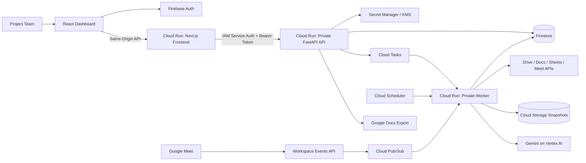
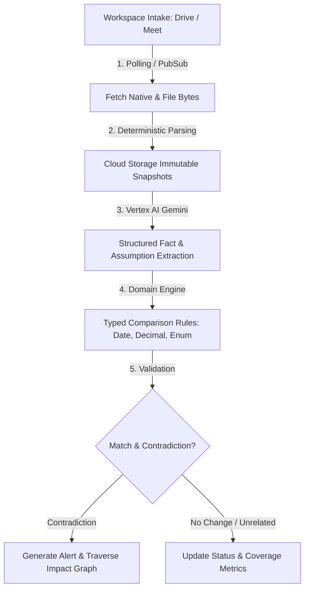

# Decision Radar: High-Level Design

**Version:** 0.5 · **Updated:** 24 September 2026 · **Status:** Proposed Workspace-Connected MVP Design

---

## 1. Purpose & Core Value

Decision Radar is an organisational memory and decision-intelligence system for project teams. It automatically detects when new information in Google Workspace undermines prior decisions, preserves the evidence and rationale behind those decisions, and visualises the downstream consequences through an interactive impact graph. It continuously ingests project artifacts, monitors active assumptions against updates, and surfaces human-in-the-loop review alerts detailing what changed, affected decisions/milestones, and supporting evidence links.

---

## 2. Users & Core Journey

### Primary User
Project Manager (manages setup, reviews alerts, exports briefs). Team members contribute Workspace updates; viewers inspect the decision register and evidence.

### Core Journey
1. **Authorize Scope:** Admin signs in via Firebase/Google and connects a My Drive folder tree (including subfolders/supported uploads) and up to 5 recurring Meet spaces.
2. **Baseline Intake:** Decision Radar extracts initial decisions, owners, assumptions, and dependencies for human confirmation.
3. **Background Sync:** App polls Drive changes (Docs, Sheets, supported uploads) and listens to Meet transcript events via Cloud Pub/Sub.
4. **Automated Analysis:** Sync updates facts; Gemini and typed comparison rules continuously evaluate active confirmed assumptions.
5. **Review Alert:** When an assumption is challenged, an alert is queued showing side-by-side original vs. update evidence with links to native Workspace sources.
6. **Human Decision:** PM keeps, revises, or retires the decision with an explicit audit trail (no auto-rewriting of sources).
7. **Export Brief:** PM previews and exports a versioned impact brief to Google Docs.

### Demonstration Scenario (Synthetic Fixture)
- **Baseline:** Doc/Meet transcript establishes *"Launch on 20 Oct 2026, assuming vendor delivery by 10 Oct."*
- **Update:** Teammate changes vendor delivery date to 24 Oct in a Sheet; subsequent Meet transcript confirms.
- **Alert:** Delivery is delayed by 14 days, violating the assumption. Decision Radar alerts PM to review launch readiness and integration testing dependencies.

---

## 3. Scope & Requirements

### Key Requirements (R1–R12)

| ID | Requirement | Acceptance Behavior |
|---|---|---|
| **R1** | Workspace Connection | Connect once; recursively discover Drive folders/files & supported uploads; fetch Meet transcripts. |
| **R2** | Structured Extraction | Suggest decision, owner, rationale, typed assumptions, and source references. |
| **R3** | Human Confirmation | Draft decisions/assumptions do not enter monitoring until confirmed by an editor. |
| **R4** | Automated Change Detection | Continuously compare active assumptions against eligible updates; no-op on unchanged syncs. |
| **R5** | Evidence Traceability | Every alert includes validated original baseline and update reference links/quotes. |
| **R6** | Impact Graph | Provide an interactive, evidence-backed graph that traverses confirmed dependencies, distinguishes direct challenges from downstream impacts, and makes the affected decision path immediately understandable. |
| **R7** | Review Workflow | Support Keep, Revise, Retire, Dismiss, and Request Clarification with audit history. |
| **R8** | Brief Export | Preview and export versioned, cited review briefs to Google Docs on explicit action. |
| **R9** | Idempotency & Recovery | Retries produce no duplicate decisions, alerts, or processing runs. |
| **R10** | Quality Evaluation | Benchmark detection precision, recall, citation accuracy, and review time. |
| **R11** | Connection Lifecycle | Automatic OAuth renewal, cursor recovery, token revocation handling, health metrics. |
| **R12** | Access-Controlled Evidence | Cite tabs, rows/cells, PDF pages, paragraphs, and transcript entries. Enforce viewer Workspace permissions. |

### System Limits & Out-of-Scope

#### MVP Capacity Controls
- **Team Size:** Up to 10 members
- **Decisions & Assumptions:** 50 active decisions, 150 active assumptions
- **Ingestion Scope:** 250 folders, 100 connected files/transcripts, 500 update facts
- **Source Limits:** 100k chars/snapshot; uploaded files ≤ 10 MB / 50 PDF pages; tables ≤ 1,000 rows × 20 cols

#### Out of Scope (MVP)
- Live call audio listening / bot joining
- Gmail / Google Chat ingestion
- Scanned/image-only PDFs requiring OCR
- Shared Drives & org-wide automatic discovery
- Auto-rescheduling or autonomous document editing

---

## 4. Architecture & Component Blueprint

Decision Radar uses a single repository deployed as three Cloud Run services: a public Next.js frontend, a private Python FastAPI API, and a private Python background worker.

### Component Responsibilities

| Component | Stack | Primary Responsibility |
|---|---|---|
| **Dashboard** | Next.js App Router + React + TS | Setup UI, source health, decision register, interactive impact graph, review queue, brief preview. |
| **Frontend Server** | Node.js (Cloud Run) | Serve web assets & proxy same-origin `/api/v1/*` requests to API via IAM auth. |
| **API Service** | Python / FastAPI (Cloud Run) | Auth verification, authorization, validation, decision/review CRUD, Doc export. |
| **Background Worker** | Python (Cloud Run) | Drive scanning, snapshot normalization, LLM extraction, comparison, evidence verification. |
| **AI Processing** | Gemini on Vertex AI | Schema-constrained extraction and semantic comparison. |
| **State & Storage** | Firestore & Cloud Storage | App state, audit history, revision data (Firestore); immutable text snapshots (GCS). |
| **Task & Sync Engine** | Cloud Tasks & Cloud Scheduler | Stage execution, retry delivery, scheduled polling, subscription renewal. |

---

## 5. Data & AI Pipeline

### Ingestion Adapters

| Source | Intake Mechanism | Ingestion Behavior |
|---|---|---|
| **Google Docs** | Drive Changes API (1 min) + Docs API | Capture all tabs, structural locators (tab, paragraph), debounce active edits. |
| **Google Sheets** | Drive Changes API + 5-min Range Read | Compare typed row/cell values; detect calculated formula value changes. |
| **Uploaded Files** | Drive Changes API + Download Media | Parse text PDFs, DOCX, TXT/MD, CSV, XLSX; extract page/paragraph/row locators. |
| **Google Meet** | Workspace Events API + Pub/Sub (5 min fallback) | Process completed transcript artifacts, preserve speaker/timestamp provenance. |

---

## 6. Evidence, Trust & Access Control Model

- **Locators & Evidence Spans:** Immutable references citing tab IDs, structural element paths, A1 cells, PDF page numbers, DOCX paragraphs, or Meet speaker timestamps.
- **Current vs. Historical:** Changing a source updates current facts for that source ID, but preserves historical snapshots and cited quotes in audit records.
- **Coverage Statuses:** App explicitly reports status: `Needs Review`, `Evidence Unclear`, or `No Detected Issue in Assessed Sources`. Disconnected or unmapped sources surface visible coverage warnings.

---

## 7. Deferred Architecture Options

| Option | Status | Rationale |
|---|---|---|
| **Agent Search / Vertex AI Search** | Optional MVP Extension | Exhaustive assumption comparison is simpler and avoids retrieval misses at small scale. |
| **ADK / Agent Engine** | Deferred | Pipeline follows known deterministic stages with explicit human checkpoints. |
| **Document AI** | Deferred | Standard text parsing covers initial file formats; scanned OCR PDFs are out of scope for MVP. |

---

## 8. Security & Compliance Checklist

- [x] **Strict Authentication:** Firebase ID tokens verified on every API request.
- [x] **Per-User Source Access Verification:** Server verifies viewer's native Workspace read permissions before displaying derived content, alerts, or briefs.
- [x] **Isolated Service Identities:** Next.js frontend has Cloud Run Invoker role for API only. Browser never touches database, storage, or AI credentials.
- [x] **Least-Privilege Scopes:** Backend uses `drive.readonly` and `meetings.space.readonly` for intake. Incremental `drive.file` requested only during user-initiated Doc export.
- [x] **Token Security:** OAuth client secrets stored in Secret Manager; refresh tokens encrypted with Cloud KMS.

---

## 9. Quality & Performance Targets

| Metric | Target | Measurement Method |
|---|---|---|
| **Alert Precision** |  >= 90 | Correct direct alerts on held-out synthetic test set (30 scenarios). |
| **Alert Recall** | >= 85 | Labeled challenged assumptions producing an alert. |
| **Citation Integrity** | 100% | Published references resolving to exact stored quote spans. |
| **Assessment Latency** | < 60s (p95) | Processing latency for <= 10 decisions & <= 20k chars. |
| **Ingestion Freshness** | < 3min Docs/Sheets, < 2min Meet | Delay from native source edit/transcript event to capture. |

---

## 10. Delivery Plan & Risk Matrix

### Two-Person, 3-Week Implementation Timeline

Development starts **25 September 2026** and completes **15 October 2026**. Work is split across two primary owners while integration, validation, and demo rehearsals are shared.

- **Engineer A — Platform & Data:** Google Workspace connectivity, ingestion, storage, backend services, infrastructure, security, and reliability.
- **Engineer B — Product & Intelligence:** Decision and assumption experience, Gemini extraction, comparison logic, impact graph, review workflow, briefs, and evaluation UX.

| Dates | Engineer A — Platform & Data | Engineer B — Product & Intelligence | Shared Exit Criteria |
|---|---|---|---|
| **25–26 Sep (Days 1–2)** | Repository/service scaffold, Firebase auth proxy, local emulators, GCP resource plan. | App shell, design tokens, decision/assumption domain contracts, synthetic demo fixture. | Authenticated web-to-API path works; fixture and schemas are agreed. |
| **27–29 Sep (Days 3–5)** | OAuth grant lifecycle, recursive Drive discovery, change cursor, immutable snapshots. | Connection/source setup UI, Gemini structured extraction, evidence-validation prototype. | A nested Doc edit produces a validated, cited decision candidate. |
| **30 Sep–1 Oct (Days 6–7)** | Sheets/CSV/XLSX mapping and normalized typed values. | Date/decimal/enum comparison rules and decision-confirmation UI. | A cell date or budget change creates a deterministic direct challenge. |
| **2–4 Oct (Days 8–10)** | Meet Events/Pub/Sub ingestion, transcript reconciliation, job idempotency. | Fact review UI, evidence viewer, uncertainty and coverage states. | A completed transcript automatically yields a traceable fact without duplicates. |
| **5–8 Oct (Days 11–14)** | Dependency APIs, graph persistence/validation, review and export service support. | Interactive impact graph, downstream-path explanation, review workflow, brief preview/export UI. | The flagship impact graph explains a direct contradiction and its downstream decisions, with native evidence links. |
| **9–11 Oct (Days 15–17)** | Security/access-control tests, monitoring, retry and recovery hardening. | Held-out evaluation suite, accessibility/usability pass, product narrative. | Quality gates pass and unauthorised evidence is never returned. |
| **12–15 Oct (Days 18–21)** | Deployment automation, runbook, performance and failure-mode fixes. | Visual polish, demo story, screenshots and presentation assets. | Two successful end-to-end rehearsals; demo is repeatable with documented limits and fallback data. |

### Delivery Principles

- Build a thin end-to-end slice by **29 September** before expanding source coverage.
- Treat the impact graph as the primary product surface for decision intelligence, not a secondary visualisation.
- Pair at the end of each phase for integration and keep work-in-progress to one major item per engineer.
- Use the synthetic fixture as a deterministic fallback so the final demo does not depend on live Workspace timing.

### Top Risks & Mitigations

| Risk | Mitigation |
|---|---|
| **OAuth Test-Mode Expiry (7-day limits)** | Re-authorize grants before demo; implement explicit token renewal checks. |
| **False Alerts & Hallucinations** | Require exact evidence matching + typed deterministic date/decimal rules. |
| **Sheet Schema Drift** | Pause affected table and surface a coverage gap when header/columns change. |
