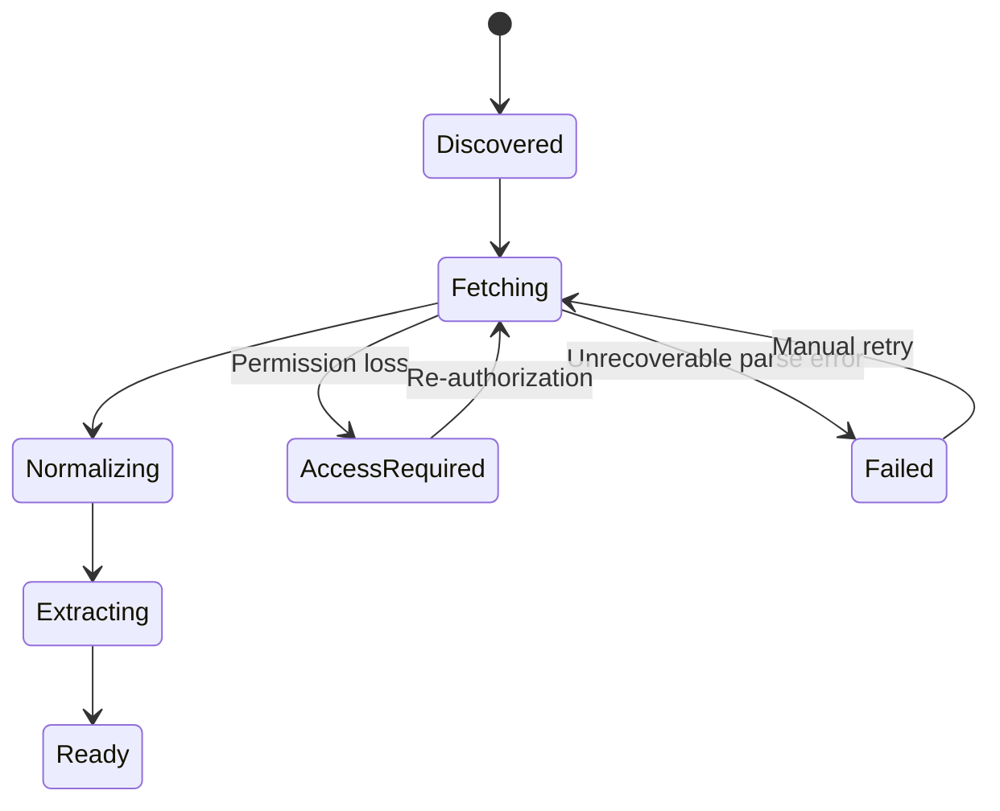
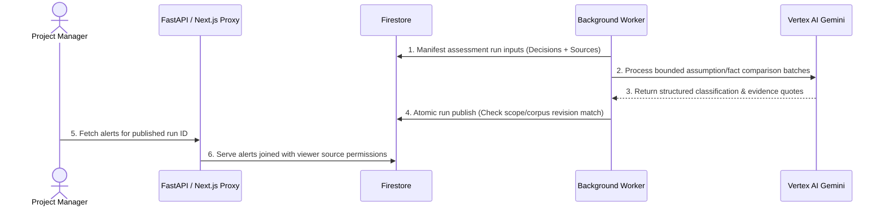

# Decision Radar: Low-Level Design

**Version:** 0.5 · **Updated:** 24 September 2026 · **Status:** Proposed Workspace-Connected Implementation Contract

---

## 1. Architecture & Module Boundaries

### Codebase Layout
```text
apps/web/                      # Next.js App Router (React + TypeScript)
  src/app/api/v1/[...path]/    # Node.js route handlers forwarding to FastAPI API
  src/components/              # UI components (cards, evidence viewer, review forms)
  src/lib/                     # Firebase Auth initialization & API client
services/radar/                # Python Core Backend (FastAPI + Worker)
  api/                         # FastAPI routes, auth, request validation
  domain/                      # Core entities, state machines, comparison rules
  connectors/                  # Workspace readers (Docs, Sheets, Meet, Drive uploads)
  pipeline/                    # Parsing, LLM extraction, comparison, publication
  adapters/                    # Firestore, Storage, Vertex AI Gemini, Cloud Tasks
  worker/                      # Private Cloud Tasks & Cloud Scheduler worker routes
infra/                         # Terraform / GCP deployment specs
```

### Module Responsibilities

| Module | Primary Contract |
|---|---|
| `ConnectionService` | Manage user OAuth grants, token refresh, disconnect/reconnect. |
| `SourceService` | Validate scope, discover native/uploaded Drive sources, persist snapshots. |
| `SyncService` | Drain Drive change cursors, reconcile recursive folder membership & freshness. |
| `MeetEventService` | Validate/deduplicate Pub/Sub transcript events, manage subscription renewal. |
| `SourceAccessService` | Verify viewer native read access for derived alerts, counts, and briefs. |
| `Normalizer` | Convert Workspace payloads & uploaded file bytes to canonical evidence spans. |
| `Extractor` | Call Gemini to extract schema-valid decision candidates and current facts. |
| `EvidenceValidator` | Validate quote containment and span IDs against stored snapshots. |
| `DecisionService` | Confirm, edit, and retire decisions with revision control. |
| `AssessmentService` | Manifest assessment inputs, plan comparison batches, track run coverage. |
| `Comparator` | Apply deterministic typed rules (date, decimal, enum) to classify evidence. |
| `ImpactService` | Traverse confirmed dependency graphs, calculate affected paths, and return explainable graph projections for the decision-intelligence UI. |
| `ReviewService` | Persist human reviewer dispositions and record decision revisions. |
| `BriefService` | Generate immutable structured brief previews and execute Docs export. |
| `JobService` | Dispatch transactional outbox tasks, manage worker leases and retries. |

### Frontend Forwarding & Auth Boundary
- **Same-Origin Proxy:** Next.js proxies browser requests from `/api/v1/*` to the private FastAPI origin.
- **Dual-Header Authentication:**
  - `Authorization: Bearer <user-firebase-id-token>` (user identity verified by FastAPI).
  - `X-Serverless-Authorization: Bearer <gcp-oidc-service-token>` (service identity verified by Cloud Run IAM).
- **Security Protocols:** Static asset caching only; `Cache-Control: private, no-store` for API responses; sensitive headers stripped before forwarding.

---

## 2. Storage Model & Schemas

### Firestore Path Structure
Root path: `projects/{projectId}/...` (except global user grants at `workspaceGrants/{grantId}`).

### Core Collections Grouped by Subsystem


#### 1. Identity & Scope Subsystem
- `members/{uid}`: Project membership (`admin`, `editor`, `viewer`).
- `connections/{id}`: OAuth grant link, root folder IDs, Meet space names, scope revision.
- `folderIndex/{folderId}`: Ancestry tree, parent IDs, matched root IDs, inventory status.
- `subscriptions/{id}`: Workspace Meet subscription ID, expiration, renewal status.

#### 2. Sources & Storage Subsystem
- `sources/{id}`: Native ID, MIME type, current version ID, status, freshness timestamp.
- `sourceVersions/{id}`: Content hash, GCS object generation, normalizer version.
- `spans/{id}`: Normalized code-point locator `hash(versionId, normalizerVersion, start, end)`.
- `sheetMappings/{id}` / `fileTableMappings/{id}`: Table header, row key, typed column definitions.

#### 3. Decisions & Facts Subsystem
- `decisions/{id}` & `decisionRevisions/{decisionId_rev}`: Statement, owner, rationale, assumptions.
- `assumptions/{id}`: Entity ID, predicate, operator, expected value, unit/currency, criticality.
- `facts/{id}`: Extracted/typed fact, entity mention, predicate, value, publication/effective dates.
- `dependencies/{id}`: Directional graph edge (`enables` / `requires_review_of`).

#### 4. Execution & Audit Subsystem
- `assessmentRuns/{id}`: Register/corpus revisions, run state (`queued`, `completed`, `partial`), coverage.
- `findings/{id}` & `alerts/{id}`: Finding fingerprint, classification, baseline & update evidence.
- `reviews/{id}`: Action (`kept`, `revised`, `retired`, `dismissed`), actor, before/after decision revision.
- `briefs/{id}` & `exports/{id}`: Immutable preview digest, export status, output Google Doc ID.
- `jobs/{id}` & `auditEvents/{id}`: Transactional task outbox, worker lease tokens, audit logs.

### Key Data Structures

#### Assumption Record Example
```json
{
  "id": "asm_delivery_01",
  "decisionId": "dec_launch_01",
  "decisionRevision": 1,
  "entityId": "vendor_acme",
  "predicate": "delivery_date",
  "operator": "on_or_before",
  "expectedValue": {"type": "date", "value": "2026-10-10", "precision": "day"},
  "criticality": "high",
  "origin": "extracted",
  "evidenceRefs": [{"sourceVersionId": "src_v1", "spanId": "span_07", "quote": "delivery by 10 October 2026"}]
}
```

#### Finding Record Example
```json
{
  "id": "fnd_01",
  "assumptionId": "asm_delivery_01",
  "decisionRevision": 1,
  "classification": "contradicts",
  "reasonCode": "DATE_AFTER_REQUIRED_BY",
  "oldValue": "2026-10-10",
  "newValue": "2026-10-24",
  "delta": {"value": 14, "unit": "calendar_days"},
  "baselineEvidence": [{"sourceVersionId": "src_v1", "spanId": "span_07", "quote": "delivery by 10 October 2026"}],
  "newEvidence": [{"sourceVersionId": "src_v2", "spanId": "span_02", "quote": "delivery is now scheduled for 24 October 2026"}]
}
```

---

## 3. State Machines & Invariants



### Core Domain Invariants
1. **Confirmed Monitoring:** Only active, confirmed decision revisions are assessed by the comparison engine.
2. **Deterministic Contradiction:** Direct alerts require confirmed baseline evidence, valid update evidence, and a failing typed comparison rule.
3. **No Automatic Mutations:** Model outputs never automatically edit decisions, alter dependency links, resolve alerts, or publish Docs.
4. **Graph Safety:** Dependency graphs enforce directed acyclic structures; self-edges and cycles are rejected at write time.
5. **Re-Review Isolation:** Re-running an assessment preserves existing human review dispositions unless a decision revision or material evidence changes.
6. **Viewer Permission Enforcement:** Derived alerts and evidence display only content for which the viewing user holds active native Workspace read permissions.

---

## 4. Public API Contracts

**Base Path:** `/api/v1/projects/{projectId}`

### API Endpoint Matrix

| Method | Endpoint Path | Request Body / Query | Success / Error Codes | Description |
|---|---|---|---|---|
| `POST` | `/connections` | `{ grantId }` | `201 Created` / `409` | Connect Workspace grant to project. |
| `PATCH`| `/connections/{id}/scope` | `{ folderIds, fileIds, meetSpaces }` | `200 OK` / `422` | Set monitored Drive folders/files & Meet spaces. |
| `GET`  | `/sources` | `?status=ready&limit=50` | `200 OK` | List monitored sources with health status. |
| `PUT`  | `/sources/{id}/sheet-mapping` | `{ sheetId, range, rowKey, columns }` | `200 OK` / `422` | Set spreadsheet table mapping rules. |
| `GET`  | `/decisions` | `?lifecycle=active` | `200 OK` | List decision cards & baseline evidence. |
| `POST` | `/decisions` | `{ statement, owner, assumptions }` | `201 Created` | Create a draft decision manually. |
| `POST` | `/decisions/{id}/confirm` | `If-Match: revision` | `200 OK` / `409` | Confirm decision draft for active monitoring. |
| `PATCH`| `/decisions/{id}` | `{ statement, rationale, assumptions }` | `200 OK` / `409` | Update decision (creates new revision). |
| `POST` | `/assessments` | `{ reason }` | `202 Accepted` | Trigger on-demand assessment run. |
| `GET`  | `/alerts` | `?reviewState=open` | `200 OK` | Paginated review alerts for published run. |
| `POST` | `/alerts/{id}/reviews` | `{ action, rationale, decisionRevision }` | `200 OK` / `409` | Submit human review (Keep, Revise, Retire). |
| `POST` | `/briefs` | `{ runId, alertIds }` | `201 Created` | Generate immutable brief preview. |
| `POST` | `/briefs/{id}/exports` | `{ provider: "google_docs" }` | `202 Accepted` | Export preview brief to Google Docs. |

### Protocol Requirements
- **Idempotency:** All state-changing endpoints accept `Idempotency-Key: <uuid>`. Duplicate requests within 24 hours return cached responses.
- **Optimistic Locking:** Mutations require `If-Match: "<revision>"`. Mismatched revisions return `409 Conflict`.
- **Standardized Error Payload:**
```json
{
  "error": {
    "code": "REVISION_CONFLICT",
    "message": "Decision updated by another user. Reload required.",
    "requestId": "req_88491",
    "retryable": false
  }
}
```

---

## 5. Workspace Sync & Normalization Engine

### 5.1 OAuth & Scope Requirements

| Scope | Usage Boundary |
|---|---|
| `https://www.googleapis.com/auth/drive.readonly` | Read-only discovery & ingestion of allowed Drive subtrees and uploaded files. |
| `https://www.googleapis.com/auth/meetings.space.readonly` | Read-only transcript retrieval for configured Meet spaces. |
| `https://www.googleapis.com/auth/drive.file` | Incremental scope requested strictly during user-initiated Google Doc brief export. |

### 5.2 Drive Ingestion Algorithm
1. **Start Token:** Call `changes.getStartPageToken` prior to initial folder enumeration.
2. **BFS Inventory Walk:** Breadth-first crawl of specified root folder IDs. Enqueue discovered subfolders up to 250 folders / 100 file limit.
3. **Cursor Drain (1 min):** Poll `changes.list` every minute. If ancestor check confirms file is within allowed tree, queue fetch job.
4. **Periodic Reconcile (5 min):** Re-verify tree ancestry, detect moved/deleted subfolders, poll Sheet ranges, check recent Meet transcript artifacts.

### 5.3 Ingestion Adapters & Limits

| Adapter | Locators & Spans | Limits & Boundaries |
|---|---|---|
| **Google Docs** | Tab ID, heading path, paragraph index, table cell coordinates. | Capture all tabs; ignore embedded drawings/comments. |
| **Google Sheets** | Sheet ID, A1 cell range, row business key. | Formula text captured; cell effective value used for comparison. |
| **Uploaded Files** | Text PDF page/block; DOCX paragraph; CSV/XLSX row keys. | $\le 10\text{ MB}$, $\le 50\text{ PDF pages}$, $\le 100\text{k chars}$. Macro execution blocked. |
| **Google Meet** | Conference name, transcript entry, speaker, timestamp span. | 7-day initial lookback; 30-day Meet API artifact availability window. |

---

## 6. Comparison Logic & Model Contracts

### Schema-Constrained Gemini Extraction
Gemini processes source text spans using structured JSON output mode to extract:
1. **Decision Candidates:** Suggested statement, owner, rationale, typed assumptions.
2. **Current Facts:** Extracted claims, entity mentions, predicate, typed value (date, amount, status), modality (`confirmed`, `tentative`, `negated`).

### Typed Comparison Rules Matrix

| Target Predicate | Comparison Rule | Result Classification |
|---|---|---|
| **Date** | Updated date strictly after assumption `on_or_before` date | `contradicts` ($\Delta$ calendar days) |
| **Numeric / Budget** | Updated decimal value strictly exceeds assumption max bound | `contradicts` ($\Delta$ value) |
| **Status / Enum** | Update confirms cancellation/failure of prerequisite | `contradicts` |
| **Value Match** | Update satisfies expected bound | `supports` |
| **Ambiguous / Unlinked** | Unapproved alias, missing reference date, tentative wording | `uncertain` |

---

## 7. Assessment Publication & Concurrency



---

## 8. Task Delivery & Retry Policy

- **Outbox Pattern:** Task outbox records created in the same Firestore transaction as state changes.
- **Worker Leases:** Worker locks job with a random lease token (6-minute expiry). Stage timeout set to 4 minutes.
- **Retry Backoff:** Exponential backoff with jitter up to 3 attempts for transient 5xx/429 errors. Terminal failures (e.g., schema drift) pause job and surface UI warnings.

---

## 9. Brief Generation & Google Docs Export

1. **Snapshot Preview:** Immutable brief created from completed assessment run & human review records.
2. **Explicit User Export:** PM clicks export, granting incremental `drive.file` scope.
3. **Doc Creation:** Worker creates Google Doc via Drive API, writes content via Docs API, and records the output document ID.
4. **Idempotent Recovery:** Export key stored in `appProperties` prevents duplicate document creation on retries.

---

## 10. UI Navigation & Component Matrix

| Screen Path | Key Components | Active State / Polling |
|---|---|---|
| `/projects/[id]` | Overview metrics, health summary, stale run warnings. | Polling source status every 10s. |
| `/projects/[id]/connections` | Folder picker, Meet space setup, pause/disconnect actions. | Immediate setup validation. |
| `/projects/[id]/sources` | Folder tree view, upload inventory, Sheet range mapper. | Progress bar during inventory crawl. |
| `/projects/[id]/decisions` | Decision cards (Draft/Active/Retired), assumption editor. | Instant optimistic UI updates. |
| `/projects/[id]/reviews` | Alert side-by-side evidence viewer, interactive impact graph, affected-path explanation, review form. | Revision checks on submission. |
| `/projects/[id]/briefs/[briefId]` | Formatted preview, evidence citation links, Doc export button. | Async export status tracking. |

---

## 11. Security & Operational Rules

- **Viewer Access Filter:** Server checks `requiredSourceIds` against viewer's Workspace grant before returning any derived alert, count, or brief.
- **Credential Storage:** Refresh tokens encrypted via Cloud KMS; client secrets stored in Secret Manager.
- **Log Privacy:** Structured logging strips source text, user OAuth tokens, document titles, and prompt contents.

---

## 12. Validation Plan & Acceptance Criteria

#### Acceptance Gates (1/2)
- **Typed Comparisons:** Correctly identify date delays and budget overruns across leap years and timezone boundaries.
- **Provenance Integrity:** 100% of published quotes match exact stored code-point locators in GCS snapshots.
- **Idempotency:** Re-running sync or task retries produces zero duplicate alerts or Firestore records.

#### Acceptance Gates (2/2)
- **Drive Discovery:** Recursive subfolder discovery and file change cursor drains execute cleanly without missing files.
- **Access Control:** Revoking user read permission on a Workspace file immediately hides associated derived alerts for that user.
- **End-to-End Verification:** Edit in Doc/Sheet or new Meet transcript automatically generates a cited alert ready for PM review within target latency bounds.


---

## 13. Two-Person Implementation Sequence

Development runs from **25 September through 15 October 2026**. Engineer A owns platform/data work; Engineer B owns product/intelligence work. Integration and release gates are shared.

| Phase & Dates | Engineer A — Platform & Data | Engineer B — Product & Intelligence | Integration Gate |
|---|---|---|---|
| **Phase 1 · 25–26 Sep** | Scaffold FastAPI/worker, Firebase auth proxy, local emulators, configuration and infrastructure skeleton. | Scaffold Next.js UI, define shared schemas, implement demo fixture and initial decision-register shell. | Authenticated health check and fixture render in the web app. |
| **Phase 2 · 27–29 Sep** | Implement OAuth lifecycle, recursive Drive crawl, cursor drain and GCS snapshot persistence. | Implement source setup flow, Gemini schema-constrained extraction and quote containment validation. | Nested Doc change creates a validated decision candidate with a resolvable locator. |
| **Phase 3 · 30 Sep–1 Oct** | Implement Sheet/file mappings and canonical typed-value normalization. | Implement date/decimal/enum rules, decision confirmation and assessment publication. | Fixture date change creates one idempotent direct finding. |
| **Phase 4 · 2–4 Oct** | Implement Meet subscription renewal, Pub/Sub handling, transcript parsing and reconciliation jobs. | Implement fact/evidence review, coverage states and ambiguity handling. | Transcript event is deduplicated and appears with speaker/timestamp evidence. |
| **Phase 5 · 5–8 Oct** | Implement dependency persistence, DAG validation, graph projection API, review/brief backend and Docs export worker. | Implement the interactive impact graph, direct-vs-downstream styling, path explanation, review state machine and brief UI. | User can follow a challenged assumption through affected decisions and export a cited brief. |
| **Phase 6 · 9–11 Oct** | Implement permission-revocation tests, retry/failure tests, telemetry and latency profiling. | Run 30-scenario evaluation, accessibility tests and usability fixes; finalise decision-intelligence narrative. | Precision, recall, citation, access-control and latency gates pass or have documented exceptions. |
| **Phase 7 · 12–15 Oct** | Finalise Cloud Run deployment, alerts/runbook, recovery drill and performance fixes. | Complete visual polish, demo data, guided story and presentation assets. | Two clean end-to-end rehearsals complete by 15 Oct with a tested fixture fallback. |

### Daily Collaboration Contract

1. Each engineer owns at most one major in-progress item at a time.
2. Schema or API changes are reviewed by the other engineer before merge.
3. The final hour of each phase is reserved for integration, acceptance checks, and Jira updates.
4. Shared release blockers take priority over new scope; optional adapters and autonomous actions remain deferred.
