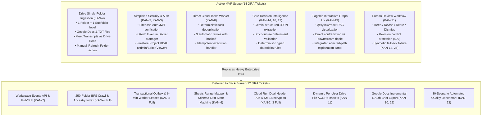
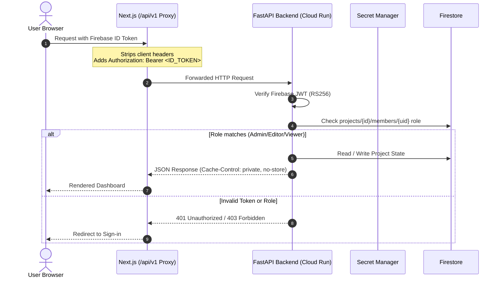
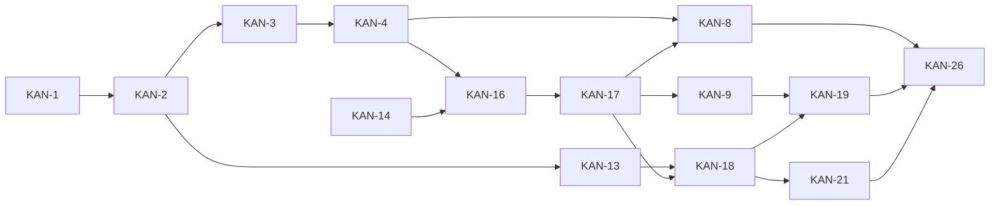

# Decision Radar: Low-Level Design (MVP Prototype)

**Version:** 1.0 (MVP Streamlined) · **Updated:** 25 September 2026 · **Status:** Active Implementation Contract  
**Target Event:** AI Builder Cup 2026 · **Sprint:** 25 September – 15 October 2026 (2 Engineers)

---

## 1. Executive Summary & MVP Scope Boundary

This document defines the streamlined Low-Level Design (LLD) for the **Decision Radar MVP Prototype**, focused strictly on delivering an impactful, robust competition demo. Non-essential enterprise infrastructure (Pub/Sub webhooks, 250-folder recursive crawlers, distributed lease engines, and runtime Drive ACL filtering) has been deferred to the `back-burner`.

### Active MVP Scope vs. Back-Burner



---

## 2. Architecture & Module Boundaries

### 2.1 Codebase Layout
```text
apps/web/                                # Next.js App Router (React + TypeScript)
  src/app/
    api/v1/[...path]/route.ts            # Node.js reverse proxy forwarding to FastAPI
    (dashboard)/
      projects/[id]/
        decisions/page.tsx               # Decision Register & Assumption Confirmation
        reviews/page.tsx                 # Alert Evidence & Flagship Impact Graph
        sources/page.tsx                 # Connected Drive Folder & Manual Refresh
  src/components/
    graph/ImpactGraph.tsx                # @xyflow/react interactive DAG component
    evidence/EvidenceViewer.tsx          # Side-by-side quote comparison & native link
    review/ReviewDrawer.tsx              # Human disposition actions (Keep/Revise/Retire)
  src/lib/
    auth/firebase.ts                     # Firebase Client Auth SDK
    api/client.ts                        # Typed API client calling /api/v1

services/radar/                          # Python Core Backend (FastAPI + Worker)
  api/
    main.py                              # FastAPI entrypoint, middleware, CORS
    deps.py                              # Firebase JWT auth dependency, project RBAC
    routes/                              # Endpoints: connections, sources, decisions, alerts, graph
  domain/
    models.py                            # Pydantic domain models (Decisions, Assumptions, Facts)
    comparator.py                        # Deterministic rules (Date delta, budget overrun)
    graph.py                             # ImpactService DAG traversal & cycle safety
  connectors/
    drive.py                             # Google Drive v3 client (folder list, doc/txt read)
  pipeline/
    extractor.py                         # Vertex AI Gemini structured extraction
    validator.py                         # Quote containment & span verifier
  adapters/
    firestore.py                         # Firestore async client wrapper
    secret_manager.py                    # GCP Secret Manager token retrieval
    cloud_tasks.py                       # Cloud Tasks dispatch helper
  worker/
    tasks.py                             # Cloud Tasks HTTP handler routes (/tasks/*)

infra/                                   # Minimal Cloud Run & Secret Manager scripts
```

### 2.2 Module Responsibilities (MVP)

| Module | Primary Contract | MVP Simplification |
|---|---|---|
| `ConnectionService` | Manages single Google OAuth grant for Drive. | Refresh token stored directly in Secret Manager; no KMS envelope encryption. |
| `SourceService` | Enumerates 1 folder + 1 subfolder level; ingests Docs/TXT. | Maximum 100 files; no continuous cursor polling; manual `Refresh Folder` trigger. |
| `Extractor` | Vertex AI Gemini 1.5 Pro / Flash structured JSON extraction. | Extracts candidate decisions, assumptions, and extracted facts with exact quote strings. |
| `EvidenceValidator` | Verifies quote containment against source text. | Rejects extraction if verbatim quote does not exist in ingested source snapshot. |
| `Comparator` | Evaluates active assumptions against extracted facts. | Deterministic date arithmetic (`DATE_AFTER_REQUIRED_BY` with $\Delta$ calendar days). |
| `ImpactService` | Projects dependency ripples from challenged assumptions. | Kahn's algorithm for DAG cycle check; returns connected subgraph for UI rendering. |
| `ReviewService` | Records human review dispositions and decision revisions. | Optimistic locking via `revisionId`; writes immutable audit trail to Firestore. |
| `CloudTasksAdapter` | Queues background ingestion and assessment jobs. | Deterministic task names (`task-{projectId}-{sourceId}-{version}`); no custom outbox. |

### 2.3 Authentication & Proxy Boundary



---

## 3. Storage Model & Firestore Schemas

All project resources are isolated under `projects/{projectId}/`. Global connection state is stored in `connections/{connectionId}`.

```text
projects/{projectId}/
├── members/{uid}                        # Role: admin | editor | viewer
├── connections/google-drive             # Folder ID, refresh status, account email
├── sources/{sourceId}                   # Ingested Docs/Transcripts & raw content
├── decisions/{decisionId}               # Confirmed decisions & active revisions
├── assumptions/{assumptionId}           # Typed assertions linked to decisions
├── facts/{factId}                       # Extracted facts from latest sources
├── dependencies/{depId}                 # Directed edges: sourceDecision -> targetDecision
├── alerts/{alertId}                     # Generated findings (contradictions)
└── reviews/{reviewId}                   # Human review audit log
```

### 3.1 Document Schemas (Pydantic / TypeScript)

#### 1. Source Document (`sources/{sourceId}`)
```json
{
  "id": "src_vendor_meeting_notes",
  "projectId": "proj_demo_2026",
  "nativeId": "1bA2c3D4e5F_drive_file_id",
  "name": "Vendor Sync & Status Notes.gdoc",
  "mimeType": "application/vnd.google-apps.document",
  "parentFolderId": "0B1234567_root_folder_id",
  "folderDepth": 1,
  "lastModified": "2026-09-24T18:30:00Z",
  "contentSnapshot": "Full normalized UTF-8 text representation of the document...",
  "status": "ready",
  "updatedAt": "2026-09-25T00:10:00Z"
}
```

#### 2. Assumption Document (`assumptions/{assumptionId}`)
```json
{
  "id": "asm_vendor_delivery",
  "decisionId": "dec_launch_readiness",
  "decisionRevision": 1,
  "statement": "Vendor Acme delivers core API adapters on or before October 10, 2026",
  "predicate": "delivery_date",
  "operator": "on_or_before",
  "expectedValue": {
    "type": "date",
    "value": "2026-10-10"
  },
  "criticality": "high",
  "evidence": {
    "sourceId": "src_launch_prd",
    "sourceName": "Product Launch PRD v1.gdoc",
    "quote": "Core API vendor integration is committed on or before October 10, 2026."
  },
  "status": "active"
}
```

#### 3. Alert / Finding Document (`alerts/{alertId}`)
```json
{
  "id": "alt_delivery_delayed",
  "projectId": "proj_demo_2026",
  "assumptionId": "asm_vendor_delivery",
  "decisionId": "dec_launch_readiness",
  "decisionRevision": 1,
  "classification": "contradicts",
  "reasonCode": "DATE_AFTER_REQUIRED_BY",
  "severity": "high",
  "baselineValue": "2026-10-10",
  "extractedValue": "2026-10-24",
  "deltaDays": 14,
  "baselineEvidence": {
    "sourceId": "src_launch_prd",
    "sourceTitle": "Product Launch PRD v1",
    "nativeUrl": "https://docs.google.com/document/d/1bA2c3D4e5F/edit",
    "quote": "Core API vendor integration is committed on or before October 10, 2026."
  },
  "updateEvidence": {
    "sourceId": "src_vendor_meeting_notes",
    "sourceTitle": "Vendor Sync & Status Notes",
    "nativeUrl": "https://docs.google.com/document/d/2yZ9x8W7v6U/edit",
    "quote": "Due to chip shortage, vendor delivery is pushed back to October 24, 2026."
  },
  "reviewState": "open",
  "createdAt": "2026-09-25T01:00:00Z"
}
```

#### 4. Dependency Edge (`dependencies/{depId}`)
```json
{
  "id": "dep_delivery_to_launch",
  "projectId": "proj_demo_2026",
  "fromDecisionId": "dec_launch_readiness",
  "toDecisionId": "dec_integration_testing",
  "relationType": "enables",
  "impactDescription": "Delays automated test suite execution and signoff"
}
```

---

## 4. Ingestion Engine (Drive Single-Folder Ingestion)

### 4.1 Ingestion Scope & Rules (KAN-4 MVP)
1. **Target Selection:** Project Admin selects **one root Google Drive folder**.
2. **Depth Limit:** Traverses files in root folder (`depth = 0`) and direct subfolders (`depth = 1`). Maximum 100 total files.
3. **Supported Formats:**
   - Google Docs (`application/vnd.google-apps.document`) $\to$ Exported as `text/plain` via Drive API.
   - Google Meet Transcripts $\to$ Stored in Drive as Google Docs or `.txt` in the `Meet Recordings/` subfolder.
   - Text files (`text/plain`, `text/markdown`).
4. **Trigger Mechanism:**
   - Initial connection scan.
   - User-initiated **"Refresh Folder"** button on the UI (enqueues a Cloud Task).

```mermaid
flowchart TD
    UI[UI: Click 'Refresh Folder'] -->|POST /sources/sync| API[FastAPI API]
    API -->|Queue Task: task-refresh-{timestamp}| CT[Cloud Tasks]
    CT -->|HTTP POST /tasks/sync-sources| Worker[FastAPI Worker Handler]
    Worker -->|drive.files.list parents in folderId| Drive[Google Drive API]
    Drive -->|File Metadata List| Worker
    Worker -->|drive.files.export mime=text/plain| Drive
    Worker -->|Save / Update Content| FS[(Firestore sources/{id})]
    Worker -->|Trigger Extractor & Comparator| Pipeline[Assessment Pipeline]
```

---

## 5. Decision Intelligence & Comparison Engine

### 5.1 Gemini 1.5 Structured Extraction (KAN-16)

When new source text is ingested, `Extractor` sends the document to Gemini using JSON structured outputs:

```python
EXTRACTION_SYSTEM_PROMPT = """
You are the Decision Radar Evidence Extractor.
Extract project decisions and factual assertions from the text.
Rules:
1. Every extracted fact or assumption MUST include an EXACT quote matching the text verbatim.
2. If dates are mentioned, extract the ISO 8601 date (YYYY-MM-DD).
3. Modality must be one of: 'confirmed', 'tentative', or 'negated'.
4. Do NOT hallucinate quotes or dates. If unsure, mark modality as 'tentative'.
"""
```

### 5.2 Deterministic Comparison Rules (KAN-17)

To prevent LLM hallucinations, contradictions are evaluated via **deterministic domain rules**:

```python
class Comparator:
    @staticmethod
    def evaluate_date_assumption(expected_date: str, actual_date: str, operator: str) -> Optional[Finding]:
        exp = datetime.date.fromisoformat(expected_date)
        act = datetime.date.fromisoformat(actual_date)
        
        if operator == "on_or_before":
            if act > exp:
                delta = (act - exp).days
                return Finding(
                    classification="contradicts",
                    reason_code="DATE_AFTER_REQUIRED_BY",
                    delta_days=delta,
                    message=f"Date {act} violates requirement on or before {exp} by {delta} calendar days."
                )
        return None
```

---

## 6. Flagship Interactive Impact Graph (KAN-9, KAN-19)

### 6.1 Server-Side Graph Traversal (`ImpactService`)
The graph engine models dependencies as a Directed Acyclic Graph (DAG). Self-loops and cyclic edges are rejected at creation time using Kahn's algorithm:

```python
class ImpactService:
    def get_impact_projection(self, project_id: str, alert_id: str) -> GraphProjection:
        # 1. Fetch Alert & Root Decision
        alert = self.db.get_alert(alert_id)
        root_id = alert.decision_id
        
        # 2. BFS Traversal along downstream edges
        nodes = []
        edges = []
        visited = set()
        queue = [root_id]
        
        while queue:
            curr = queue.pop(0)
            if curr in visited:
                continue
            visited.add(curr)
            
            decision = self.db.get_decision(curr)
            is_trigger = (curr == root_id)
            nodes.append(GraphNode(
                id=curr,
                label=decision.statement,
                node_type="trigger" if is_trigger else "downstream",
                status="challenged" if is_trigger else "affected",
                owner=decision.owner,
                evidence=alert.baseline_evidence if is_trigger else None
            ))
            
            for dep in self.db.get_downstream_dependencies(curr):
                edges.append(GraphEdge(
                    id=dep.id,
                    source=curr,
                    target=dep.to_decision_id,
                    relation=dep.relation_type,
                    label=dep.impact_description
                ))
                queue.append(dep.to_decision_id)
                
        return GraphProjection(root_id=root_id, nodes=nodes, edges=edges)
```

### 6.2 Frontend Visualization (`@xyflow/react`)
The UI renders the projection using custom nodes in `@xyflow/react`:
- **Challenged Trigger Node (Red/Amber Border):** Displays the violated assumption, delta badge (`+14 Days`), and evidence link.
- **Downstream Affected Nodes (Blue/Neutral Cards):** Show impacted milestones, owners, and dependency rationale.
- **Side Panel Integration (Absorbing KAN-20):** Clicking any node opens the detail drawer displaying the exact path traversal from the root contradiction to the selected node.

---

## 7. Public API Contracts (MVP)

All routes are served under `/api/v1/projects/{projectId}/`:

| Method | Endpoint | Purpose | Key Payload / Query |
|---|---|---|---|
| `POST` | `/connections/google-drive/authorize` | Start a server-side Drive OAuth grant | Returns `{ "authorization_url": "..." }`; project admin only. |
| `GET` | `/connections/google-drive` | Read safe Drive connection status | Refresh token and Secret Manager reference are never returned. |
| `POST` | `/connections/google-drive/reconnect` | Start re-authorisation after revocation or expiry | Returns `{ "authorization_url": "..." }`; project admin only. |
| `DELETE` | `/connections/google-drive` | Revoke and disconnect the Drive grant | Destroys stored refresh-token versions and marks the connection disconnected. The empty secret container remains for a later reconnect. |
| `POST` | `/sources/sync` | Trigger manual folder refresh | Empty body $\to$ returns `{ "taskId": "task-123", "status": "queued" }` |
| `GET` | `/sources` | List ingested files & status | Returns `[{ "id": "...", "name": "...", "status": "ready" }]` |
| `GET` | `/decisions` | List decision register | Query `?status=active` |
| `POST` | `/decisions` | Create decision + assumption | `{ "statement": "...", "assumptions": [...] }` |
| `POST` | `/decisions/{id}/confirm` | Confirm decision draft | Moves decision to active monitoring |
| `GET` | `/alerts` | Get alerts review queue | Returns open alerts with baseline vs update evidence |
| `GET` | `/alerts/{id}/graph` | Get impact graph projection | Returns nodes & edges for `@xyflow/react` |
| `POST` | `/alerts/{id}/reviews` | Submit human disposition | `{ "action": "revise", "rationale": "...", "revision": 1 }` |
| `POST` | `/fixture/reset` | Reset demo scenario | Seeds the vendor delay (10 Oct $\to$ 24 Oct) fixture data |

### Error Payload Specification
```json
{
  "error": {
    "code": "REVISION_CONFLICT",
    "message": "Decision has been updated by another action. Please reload.",
    "status": 409
  }
}
```

---

## 8. Synthetic Demo Fixture & Deterministic Fallback (KAN-14, KAN-26)

To ensure the live competition pitch never fails due to network or Google API latency:
1. **Endpoint `POST /api/v1/projects/{projectId}/fixture/reset`**:
   - Seeds `Product Launch PRD v1` (Launch 20 Oct, assumed vendor delivery 10 Oct).
   - Ingests `Vendor Meeting Notes` with 24 Oct delivery date.
   - Emits Alert `alt_delivery_delayed` with +14-day delta.
   - Connects dependency edge to `Integration Testing` and `Production Go-Live`.
2. **Demo Mode Toggle in UI:** A header badge enables "Live Mode" (calls Google Drive API) or "Fixture Mode" (runs deterministic cached scenario).

---

## 9. Two-Person Implementation Roadmap (14 Active Tasks)

The plan uses direct prerequisites only. Transitive prerequisites are deliberately omitted from Jira links so the board remains readable while still enforcing the full delivery order.

| Milestone | Dates | Ready work, in implementation order | Exit outcome |
|---|---|---|---|
| **M0A — prerequisite-free foundations** | **25 Sep** | **KAN-1**: FastAPI & worker scaffold<br/>**KAN-14**: Domain schemas & demo fixture | Both engineers can start immediately; the executable boundary and shared contracts exist. |
| **M0B — secured application shell** | **26–27 Sep** | **KAN-2** after KAN-1<br/>**KAN-13** after KAN-2 | Authenticated proxy works and the application shell consumes the shared API boundary. |
| **M1 — connected evidence** | **28 Sep–1 Oct** | **KAN-3** after KAN-2<br/>**KAN-4** after KAN-3<br/>**KAN-16** after KAN-4 and KAN-14 | **Thin E2E slice:** a Drive document is ingested and produces a quote-validated extraction. |
| **M2 — decision signal** | **2–4 Oct** | **KAN-17** after KAN-16<br/>Then in parallel: **KAN-8** after KAN-4 and KAN-17; **KAN-18** after KAN-13 and KAN-17 | The date change creates one deterministic finding, runs idempotently, and renders with its evidence. |
| **M3 — decision intelligence demo** | **5–8 Oct** | **KAN-9** after KAN-17<br/>**KAN-21** after KAN-18<br/>**KAN-19** after KAN-9 and KAN-18 | The impact graph and human review flow are presentation-ready. |
| **M4 — prototype hardening** | **9–15 Oct** | **KAN-26** after KAN-8, KAN-19, and KAN-21 | Two consecutive end-to-end rehearsals succeed using the fixture fallback. |

### 9.1 Direct Jira prerequisite graph



The Kanban rank follows the same topological order: **KAN-1, KAN-14, KAN-2, KAN-13, KAN-3, KAN-4, KAN-16, KAN-17, KAN-8, KAN-18, KAN-9, KAN-21, KAN-19, KAN-26**. KAN-1 and KAN-14 are the only prerequisite-free active tasks and therefore lead the To Do queue.

---

## 10. Traceability Matrix to Jira Issues

| Active Jira Issue | Title & Scope | LLD MVP Section |
|---|---|---|
| **KAN-1** | Scaffold FastAPI, worker and infrastructure | §2.1 Codebase Layout, §2.2 Module Responsibilities |
| **KAN-2** | Implement Firebase auth proxy and security baseline | §2.3 Auth & Proxy Boundary |
| **KAN-3** | Implement OAuth grant lifecycle | §2.2 Module Responsibilities, §3 Firestore Schemas |
| **KAN-4** | Build Drive discovery (Single-folder MVP) | §4 Ingestion Engine |
| **KAN-8** | Add idempotent jobs (Direct Cloud Tasks) | §4 Ingestion Engine, §2.2 CloudTasksAdapter |
| **KAN-9** | Build dependency graph persistence and projection API | §6.1 ImpactService Traversal |
| **KAN-13** | Build app shell and design system | §2.1 Codebase Layout |
| **KAN-14** | Define domain schemas and synthetic demo fixture | §3 Storage Model, §8 Synthetic Demo Fixture |
| **KAN-16** | Implement Gemini extraction and evidence validation | §5.1 Gemini Extraction & Quote Containment |
| **KAN-17** | Implement typed comparison and decision confirmation | §5.2 Deterministic Comparison Rules |
| **KAN-18** | Build evidence viewer and coverage states | §3.1 Alert Document Schema, §7 API Contracts |
| **KAN-19** | Build interactive impact graph (absorbs KAN-20) | §6.2 `@xyflow/react` Component & Path Panel |
| **KAN-21** | Implement human review workflow | §3.1 Review Schema, §7 API Contracts |
| **KAN-26** | Product demo readiness and user-flow rehearsal | §8 Synthetic Fixture, §9 Implementation Roadmap |
