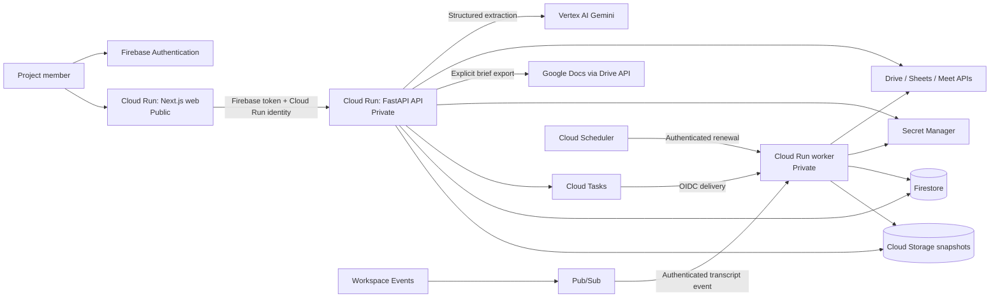
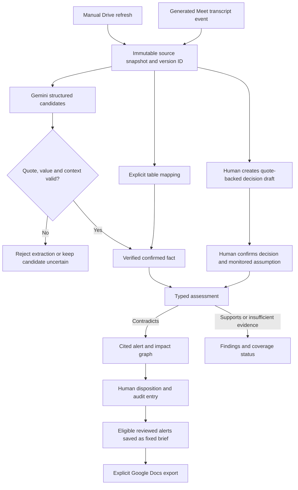

# Decision Radar: Technical Submission Documentation

**AI Builder Cup 2026 submission**

**Category:** Future of Work & Enterprise Productivity

**Team GeminiMaxx:** Steffy Lo & Mike Umali

**Documentation date:** 17 October 2026

This document describes the implementation on `main` through 16 October and the dated test records cited below. A merged feature does not establish that every deployed service runs the same revision. Remaining release checks are stated explicitly.

| Item | Link or status |
| --- | --- |
| Live prototype — Cloud Run staging | [Decision Radar](https://decision-radar-web-ngm5jlvo5q-as.a.run.app) |
| Three-minute demo video | Recording and public link pending |
| Proposal deck — editable | [DecisionRadar_Proposal.pptx](DecisionRadar_Proposal.pptx) |
| Proposal deck — PDF for review | [DecisionRadar_Proposal.pdf](DecisionRadar_Proposal.pdf) — exported and visually reviewed; add the final video link and re-export before submission |
| Source code | [steffy-lo/decision-radar](https://github.com/steffy-lo/decision-radar) |

The homepage opens a labeled synthetic fixture. A connected project requires an authorised Google test user and project membership; an administrator manages OAuth grants. Judge access to the connected flow must be arranged and tested before submission. No account credentials belong in this document or the repository.

See the [submission checklist](SUBMISSION_CHECKLIST.md) for completed material checks and the remaining release, access and video requirements.

## 1. Summary

Decision Radar preserves the evidence and rationale behind project decisions. It connects to a selected Google Drive folder, uses Gemini on Vertex AI to extract candidate decisions and facts, validates their source quotes, and compares verified facts with confirmed assumptions. A contradiction produces an alert with the original and updated evidence. An interactive graph shows the challenged decision and downstream effects through recorded dependencies.

A person can keep, revise, retire, dismiss, or request clarification, with a rationale recorded in audit history. Reviewed alerts can be saved in a fixed brief and explicitly exported to Google Docs. Drive refresh is manual; automatic Meet intake processes generated transcripts from monitored spaces rather than listening to a live call.

Gemini interprets source language, typed rules evaluate comparisons, and people control decision changes.

## 2. Problem and theme alignment

Teams make decisions using assumptions about vendor dates, budgets, and delivery status. Later updates arrive in documents, tables, and meetings while the decision record stays unchanged. Someone must find the update, identify the assumption it challenges, and reconstruct which other decisions depend on it.

Decision Radar addresses the knowledge-access and decision-making goals of the [Future of Work & Enterprise Productivity theme](https://aibuildercup.com/themes.html). Its intended users are project managers, contributors, and colleagues inheriting project context. Intended benefits include less manual evidence gathering, earlier review of affected plans, and clearer handovers. Productivity gains and adoption have not yet been measured in a customer pilot.

| Project example | Evidence and interpretation |
| --- | --- |
| Original requirement | Acme Logistics must deliver on or before 15 October 2026. The confirmed assumption retains its baseline quote. |
| Confirmed update | “Acme Logistics delivery date is October 24, 2026.” The extracted value must resolve to source evidence. |
| Comparison | 24 October is nine calendar days after 15 October. Typed date rules produce the contradiction. |
| Impact | The directly challenged decision is distinct from projected effects on decisions linked by recorded dependencies. |
| Human response | A reviewer records a disposition and rationale; the audit and brief preserve the response. |

This nine-day scenario is recorded in [quality UAT](../docs/KAN23_QUALITY_EVALUATION.md). The separate [built-in fixture](../fixtures/README.md) uses 10 October → 24 October, a fourteen-day difference. Both use synthetic project content; the connected UAT uses real Google services.

## 3. What the prototype does

| Step | User-visible behaviour | Implementation |
| --- | --- | --- |
| 1. Connect | Sign in with Google, connect one Drive folder, and refresh its files and direct subfolders. Background status shows queued, running, completed, or a recoverable error. | Firebase Authentication, Google OAuth, Secret Manager refresh tokens, Cloud Tasks refresh handler. |
| 2. Extract | Select a confirmed monitored assumption, enter trusted entity/predicate wording, and click **Extract with Gemini**. Inspect suggested decisions and verified or uncertain facts with source quotes. | Vertex AI structured extraction; typed-value, context, alias, modality, and citation checks. Extraction runs through the API. |
| 3. Confirm | Create a quote-backed decision draft, review its owner, rationale, and monitored date, then confirm it. | Decision revisions and explicit draft → active confirmation; optimistic concurrency checks. Model suggestions do not automatically become active decisions. |
| 4. Assess | Click **Run assessment** to compare current usable facts with active assumptions. Inspect findings and incomplete coverage. | Private worker, deterministic date/decimal/enum comparison, input fingerprints and stable result IDs. |
| 5. Explain | Open **View impact graph**, select a node, and inspect the ordered path and recorded dependency rationale. | Dependency persistence, cycle checks, graph projection, React Flow UI with mouse and keyboard selection. |
| 6. Review | Choose Keep, Revise, Retire, Dismiss, or Request clarification and enter a rationale. Reload to inspect the audit entry. | Review persistence, idempotency and revision checks; before/after revisions for decision-changing actions. |
| 7. Brief and export | Select eligible reviewed alerts, create a fixed preview, authorise export, and open the resulting Google Doc. | Immutable brief snapshot, current-evidence checks, explicit `drive.file` grant, export receipt and existing-document recovery on retry. |
| 8. Manage sources | Inspect source health and freshness; pause/resume assessment, map tables, or monitor a Meet space. | Persisted monitoring state, schema-drift handling, Workspace Events/Pub/Sub transcript intake and subscription renewal. |

**Supported intake:** Google Docs, UTF-8 TXT, saved Meet transcript Docs/TXT, native Google Sheets, CSV, and XLSX. Drive scope is the root folder plus one subfolder level, with a 100-file cap. Saved transcripts found in Drive and automatically delivered Meet transcripts are separate intake paths.

The current manual decision form creates a date assumption. The domain supports date, decimal, and enum comparisons; table mappings can publish all three fact types. Confirming an initial decision is necessary before the Sources extraction UI offers an active assumption.

## 4. Use of Google AI

### 4.1 Model and call pattern

- **Adapter:** the Google Gen AI SDK calls Vertex AI from the server. Source defaults are `VERTEX_MODEL=gemini-2.5-flash` and `VERTEX_LOCATION=us-central1`; both are configurable. They are defaults, not an assertion about every deployed revision.
- **Structured output:** `response_mime_type="application/json"`, a Pydantic `ExtractionDraft` response schema, and `temperature=0`.
- **Candidates:** decision statements, owners when present, rationale, typed assumptions, and facts with entity, predicate, value, modality, and a supporting quote. Fact modality is `confirmed`, `tentative`, or `negated`.
- **Execution:** `POST /sources/{source_id}/extract` invokes the extractor in an API thread pool. The registered Cloud Tasks business handlers are refresh and analysis; extraction is not currently a separate queued job.

Source: [Gemini adapter](../services/radar/pipeline/gemini.py), [extraction validator](../services/radar/pipeline/extraction.py), and [source routes](../services/radar/api/routes/sources.py).

### 4.2 Why Gemini is useful here

Documents and transcripts express the same entity or event in different language. Gemini proposes structured interpretations of those passages, reducing the need to transcribe every fact manually. Editors still provide trusted entity/predicate wording for the selected assumption; the prototype does not claim unrestricted automatic entity resolution. Structured tables use explicit column mappings rather than requiring Gemini to infer their schema.

### 4.3 How the model is constrained

1. **Source treatment:** the system instruction treats source text as data, requires supporting quotes, and prohibits inventing omitted owners, entities, or dates.
2. **Citation verification:** each accepted quote resolves to one exact character span in a versioned source snapshot. A whitespace-only variation is accepted only when it identifies one span; the saved citation uses the actual source characters. Absent or ambiguous quotes reject extraction rather than becoming verified evidence.
3. **Typed values and trusted mappings:** entity/predicate aliases must resolve to trusted identifiers, and values must be visible in the quote. Incomplete context or unresolved mappings leave candidates uncertain and ineligible for alert publication.
4. **Modality filtering:** tentative and negated statements do not become confirmed contradiction evidence. Surrounding text is checked for qualifiers as well as the quoted fragment.
5. **Deterministic comparison:** Gemini does not calculate whether a date, decimal, or enum violates an assumption. Typed rules do. Date comparisons use calendar dates; offset-bearing timestamps are rejected instead of silently cast to a day.
6. **Verified-result reuse:** when the source snapshot, monitored assumption, alias wording, and saved verified fact still match, extraction reuses the verified result. This addresses the observed unchanged-input regression; fresh/changed-input model variance remains unmeasured.
7. **Explicit coverage:** findings classify supported or contradicted comparisons. Coverage separately records `assessed`, `uncertain`, or `unassessed`, so no-alert results do not conceal missing evidence.

## 5. Architecture

The staging environment uses Google Cloud project `geminimaxxing-509705`, Cloud Run in `asia-southeast1`, and the named Firestore database `decision-radar`. The main deployment has separate web, API, and worker services. Meet event UAT also used an isolated private worker; its results do not establish a completed integrated production rollout.



| Component | Stack | Responsibility |
| --- | --- | --- |
| Web | Next.js App Router, React, TypeScript, React Flow | Connections, decisions, sources, reviews, graph and briefs; same-origin `/api/v1/*` proxy. |
| API | Python, FastAPI, Pydantic | User verification, project roles, OAuth callbacks, extraction, decision/review APIs, job dispatch, briefs and export. |
| Worker | Python, FastAPI | Queued Drive refresh and assessment; authenticated Meet event intake and subscription renewal where configured. |
| State | Firestore | Project membership, sources, versions/spans, decisions/revisions, assumptions, facts, findings, alerts, reviews, jobs, briefs and exports. |
| Evidence storage | Cloud Storage | Content-addressed immutable source snapshot objects; hashes and version metadata are retained in Firestore. |
| Secrets | Secret Manager | Project-scoped OAuth refresh-token storage. New grants rotate token versions; disconnect destroys stored token versions. |
| Delivery | Cloud Tasks; Pub/Sub; Cloud Scheduler | Task retries and receipts; Meet event delivery; periodic subscription renewal. |

**Request boundary:** the browser sends its Firebase ID token to the web origin. The proxy forwards it in `Authorization` and uses a Cloud Run ID token in `X-Serverless-Authorization` to invoke the private API. The web identity has invocation access to the API; task delivery uses its configured worker identity. The browser does not receive server-side AI, storage, or OAuth credentials.

Main protected routes are under `/api/v1/projects/{project_id}`:

| Area | Routes |
| --- | --- |
| Membership and connection | `GET /me`; `/connections/google-drive/*`; `/connections/google-meet/*`; `/meet-spaces` and stop/reconcile actions. |
| Sources | `GET /sources`; `POST /sources/{source_id}/extract`; extraction, version and span reads; `PUT /sources/{source_id}/sheet-mapping`; `PATCH /sources/{source_id}/monitoring`. |
| Background work | `POST /jobs/refresh`; `POST /jobs/analysis`; `GET /jobs/{job_id}`; `POST /jobs/{job_id}/retry`. |
| Decisions and impact | Decision create/list/update/confirm/retire; `/dependencies`; `GET /alerts/{alert_id}/graph`. |
| Assessment and review | `GET /assessments/results`; `POST /assessments` for the direct assessment API; `GET/POST /alerts/{alert_id}/reviews`. The UI analysis control uses the job route. |
| Briefs | `GET/POST /briefs`; `GET /briefs/{brief_id}`; `POST /briefs/export-authorization`; `GET/POST /briefs/{brief_id}/exports`. |

The OAuth callback is `/api/v1/oauth/google/callback`; local API Swagger is at `/docs`. Private-service IAM remains applicable to deployed API documentation.

## 6. Data pipeline



The diagram shows logical dependencies, not automatic orchestration. Users explicitly refresh Drive, extract text, confirm decisions, run assessment, review, and export. A model-suggested decision is not automatically persisted as an active decision.

Snapshot versions depend on normalised content; span IDs bind the quote offsets to that version. Changed content creates a new version while earlier cited snapshots remain available. Unchanged content does not require another version. Table facts retain row/cell locators; schema drift pauses affected facts until the mapping is repaired.

Jobs use project-scoped deterministic identities and immutable input manifests. Repeated unchanged submissions can reuse completed receipts. Worker publication and assessment results have stable IDs to make supported retries idempotent. A stale failed job whose inputs changed must be replaced by a new request. These controls have specific tests; they are not an unlimited exactly-once guarantee for every external-service failure.

## 7. Security and trust

- Protected project routes verify Firebase identity and membership with `admin`, `editor`, and `viewer` roles. Health and OAuth callback routes use their appropriate separate boundaries; not every endpoint requires a Firebase token.
- Admins manage connections, folder refresh, table mapping and monitoring. Editors can create/confirm decisions, extract facts, assess, review, and prepare/export briefs. Brief access is restricted to editors/admins in the current API.
- API and worker are private Cloud Run services. Task, Pub/Sub, and renewal handlers validate their configured OIDC audience and service-account identity.
- Intake uses `drive.readonly`; Meet has a separate `meetings.space.readonly` grant. Google Docs export requests `drive.file` explicitly and preserves the read grant.
- Refresh tokens live in Secret Manager rather than source control or Firestore records. Per-project secrets and narrow service permissions need provisioning before first connection; this remains an onboarding requirement.
- Uvicorn access logging is disabled in the API image because callback URLs can contain one-time codes. Cloud Run request metadata can still retain query strings; this setting does not itself prove safe platform-log retention.
- The production web callback requires `RADAR_WEB_ORIGIN` and fails closed when it is absent. OAuth state is bound to the project/user and browser flow.
- The system reads source files and creates a separate export Doc; it does not rewrite the original evidence. Assessment does not autonomously revise a decision. Human writes use revision/concurrency checks and audit history.
- **Permission boundary:** project roles are implemented. Rechecking each viewer's current native Drive permissions before showing all derived content remains deferred in KAN-11. A controlled unavailable-access display or emulator test is not proof of native permission enforcement.

## 8. Scalability

- **Separate compute:** stateless web, API and worker services can be scaled and permissioned separately. Worker request concurrency, queue dispatch rate and downstream quotas must be tuned together; queue depth alone does not establish an autoscaling policy.
- **Bursts and retries:** Cloud Tasks buffers work and retries deliveries. Deterministic receipts and publication IDs reduce duplicate processing for tested paths. Changed input manifests need new jobs.
- **Project scope:** state, membership and OAuth connection records are scoped to projects. This does not replace native file-level access checks.
- **AI work reuse:** unchanged verified inputs can avoid another model call. Cost savings and throughput under load have not been benchmarked.
- **Comparison scope:** the current service plans predicate-matched comparisons in bounded batches across active assumptions, retaining explicit coverage. Graph projection enforces limits of 500 dependency edges and 1,000 affected paths. Large-project throughput and production latency remain unmeasured.
- **Future scale:** evaluate retrieval such as Vertex AI Search for larger evidence collections, along with quotas, backpressure, retention and per-project cost. Retrieval and portfolio views are roadmap work, not implemented dependencies.

## 9. Current limits

- Staging OAuth is restricted to configured test users. Public consent verification, judge access and production onboarding are not established by a successful internal demo.
- Drive intake is manual, bounded to one folder plus direct subfolders and 100 files. It is not arbitrary recursive discovery or continuous Drive change polling.
- Demo content is synthetic. Fresh extraction variance on changed evidence and human productivity benefits remain unmeasured; reuse mitigates unchanged-input variance only.
- Native per-viewer Drive permission enforcement is deferred. Project RBAC should not be presented as inherited Workspace ACL filtering.
- Date comparisons are day-only. Timestamp-bearing evidence needs explicit timezone handling or a human-confirmed calendar date; automatic normalisation is not implemented.
- Meet intake occurs after transcript generation. Real automatic intake was tested, but a substantive spoken update through citation, assessment and review still needs rehearsal. Empty transcripts do not produce useful facts.
- Source freshness and mapping validity constrain assessment and brief creation. A stale reviewed alert can be rejected when preparing a new brief; an existing fixed brief preserves its original content.
- A clean integrated deployment, per-project secret bootstrap and transient worker recovery drill remain release work. Feature-level UAT does not establish two consecutive final rehearsals through all new dependencies and export.
- OCR/scanned PDFs, Gmail, Google Chat, Shared Drives, organisation-wide discovery and portfolio views are outside the implemented prototype.

## 10. Roadmap

| Stage | Scope |
| --- | --- |
| Implemented with dated UAT | Drive Doc/TXT ingestion, versioned evidence, Gemini extraction, decision confirmation, typed comparison, impact graph/path explanations, five human review actions, table mappings, source pause/resume, automatic Meet transcript intake, reviewed briefs and explicit Docs export. See the linked UAT records for each test's environment and limits. |
| Release completion | Integrate and deploy the final services together; complete clean deployment and transient recovery; provision project secrets; rehearse the full user path through export twice; finish accessibility, screenshots, deck PDF, video and judge-access checks. KAN-12, KAN-24, KAN-25 and KAN-26 remain open in the latest inspected board. |
| Trust follow-up | Native per-viewer Drive ACL enforcement and production observability (KAN-11); changed-input model evaluation, timestamp/date handling and measured pilot outcomes. |
| Later exploration | Larger-scale retrieval, Jira/Chat/Gmail connectors, Shared Drives and organisation-wide discovery, and cross-project portfolio views. |

The older [MVP design](../docs/LLD_MVP.md) and September scope retain exclusions that predate the implemented table, Meet and brief features. Use this document's source links and dated evidence to distinguish current capabilities from the earlier plan.

## 11. Running locally

**Prerequisites:** Python 3.10+, Node.js 20.9+, Java compatible with the installed Firebase emulator suite, and Firebase CLI. Use your own authorised Google sign-in for live services. Keep local environment files untracked.

From the repository root, create the backend environment:

```sh
python3 -m venv services/radar/.venv
services/radar/.venv/bin/python -m pip install -r services/radar/requirements.txt
cp services/radar/.env.example services/radar/.env
```

Install workspace and web dependencies and create the web configuration:

```sh
npm ci
npm --prefix apps/web ci
cp apps/web/.env.example apps/web/.env.local
```

These copy commands are for first-time setup; preserve existing configured files. Fill in the Firebase web values in `.env.local`. Match the backend/web project IDs and local Auth/Firestore emulator settings. Configure an API project-membership record for the signed-in user's UID; sign-in alone does not create membership.

From the repository root, start each process in a separate terminal:

```sh
npm run emulators
npm run dev:api
npm run dev:worker
npm run dev:web
```

Default local ports are web `3000`, API `8000` (`/docs`), worker `8001`, and emulator UI `4000`. Starting the HTTP worker alone does not configure or emulate Cloud Tasks delivery.

| Capability | Additional configuration |
| --- | --- |
| Live extraction | `VERTEX_PROJECT_ID`, optionally `VERTEX_LOCATION` / `VERTEX_MODEL`, and a server identity authorised for Vertex AI. |
| Drive/Meet consent | `GOOGLE_OAUTH_CLIENT_ID`, `GOOGLE_OAUTH_CLIENT_SECRET`, an exact registered `GOOGLE_OAUTH_REDIRECT_URI`, approved test account and Secret Manager access. Use a distinct Meet connection grant. |
| Named cloud database and snapshots | `FIREBASE_PROJECT_ID`, `FIRESTORE_DATABASE_ID`, `SOURCE_SNAPSHOT_BUCKET`, and authorised server credentials. Remove emulator variables when intentionally using cloud services. |
| Queued refresh/analysis | `CLOUD_TASKS_LOCATION`, `CLOUD_TASKS_QUEUE`, `TASK_WORKER_URL`, `TASK_WORKER_AUDIENCE`, `TASK_SERVICE_ACCOUNT_EMAIL`, and a reachable worker with matching IAM/OIDC settings. |
| Meet events/renewal | `MEET_EVENTS_TOPIC`, authenticated Pub/Sub push and renewal audience/account settings, provisioned subscription delivery and Scheduler. |
| Deployed web proxy | `RADAR_API_URL`, `RADAR_API_AUDIENCE`, `RADAR_WEB_ORIGIN`, Firebase authorised domain and service-to-service invocation permission. |

Without live services, the home page's **Explore demo workspace** opens [the fixture](../fixtures/vendor-delay.json). It demonstrates the synthetic decision/evidence/graph narrative; it does not prove live calls or persist review actions and has no live brief export.

For a manual acceptance run: connect and refresh a dedicated folder → create and confirm an exact-quote decision → extract the changed fact → assess → inspect both citations and graph → save and reload a review → create and reload a brief → export and inspect the actual Google Doc. Record revisions, job/run/alert IDs, expected versus actual values, errors and retries. Repeat with fresh evidence/reviewable alerts, check unchanged replay, and exercise failure/recovery. Do not erase audit history to simulate a fresh run.

Deployment references: [web and proxy](../docs/CLOUD_RUN_WEB_DEPLOYMENT.md), [worker and delivery](../docs/CLOUD_RUN_WORKER.md), and [open deployment/recovery PR](https://github.com/steffy-lo/decision-radar/pull/27). Design context: [HLD](../docs/HLD.md) and [MVP LLD](../docs/LLD_MVP.md); implementation links above take precedence where the older plan differs.

## 12. Team

Both team members contribute across implementation, integration, testing and delivery. The focus areas below describe recorded contributions rather than exclusive ownership.

| Member | Contribution focus |
| --- | --- |
| Steffy Lo | Backend/infrastructure foundations, Firebase authentication/security, OAuth lifecycle, background job delivery, dependency APIs and interactive impact graph. |
| Mike Umali | App shell and domain contracts, Drive/Gemini evidence pipeline, typed assessment and decision confirmation, evidence/review experience, feature integration and hands-on UAT. |
